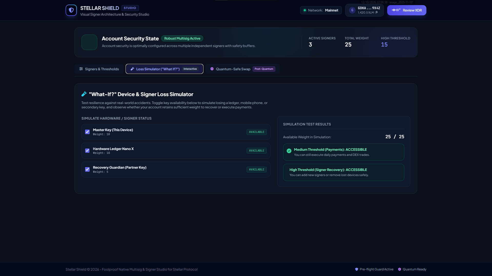
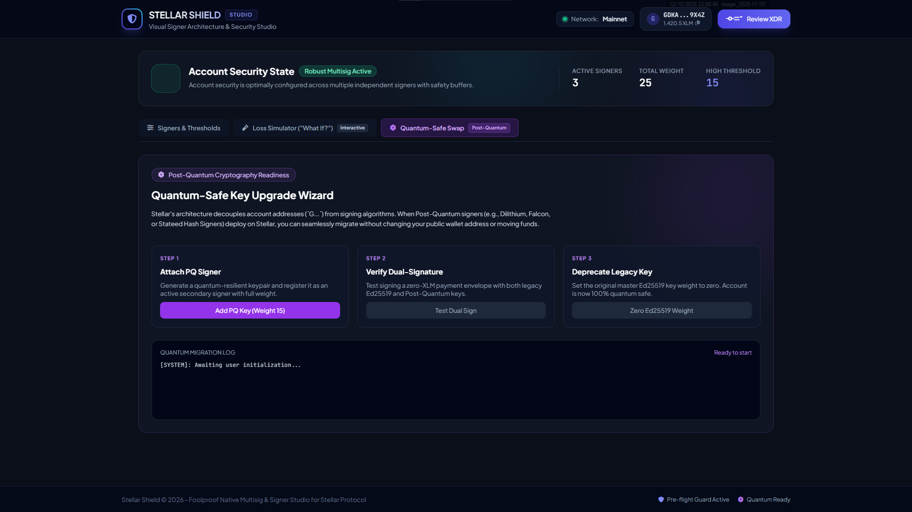
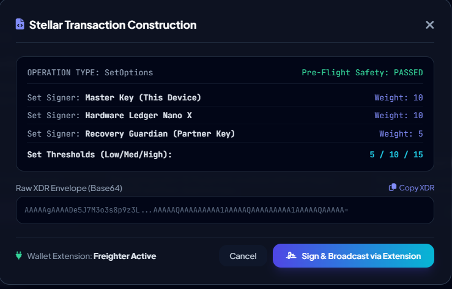

# Stellar-Signer Web Interface (Visual Simulation Only)
A dedicated web-based tool for Stellar account security, multi-signature management, visual threshold validation, and post-quantum key migration. Currently a visual simulation only.

  

| Loss Simulator | Post-Quantum Swap | XDR Preview
| :---: | :---: | :---: |
|  |  | 
